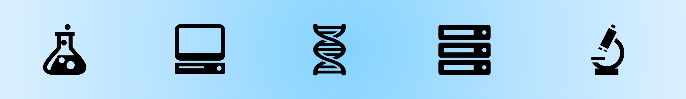

# Course Introduction

Plan for today:

- Course Introduction
- Understand the goals of RNA-seq
- Understand what we can learn from RNA-seq
- Become familiar with the “vanilla” RNA-seq protocol
- Learn how to log into ALPINE and install required software for this course

## Welcome to class!

- Prior LINUX experience - strongly encouraged
- Prior ALPINE experience - will be helpful but not required
- Prior R experience - will be helpful but not required

## Intro to instructor: 

- Erin Osborne Nishimura, PhD

## Intro to class:

- Please read through the [Syllabus](../../README.md/#syllabus) to learn more about the class.
- This class is the last in a 3-part series. The other two classes are **DSCI510 LINUX** and **DSCI511 Python**. This class focuses on building pipelines and computational projects in LINUX and R using RNA-seq data analysis as an example.
- The course will be primarily accessed through this GitHub page. There is a Canvas page for the class and this will be the area to turn in assignments, see grades, complete the class quizes, and complete the course survey!

Please take this [brief survey]( )

-----

## Learning Objectives

By the end of this course, you should master the following learning objectives:

  * Understand the goals, benefits, and limitations of RNA sequencing (RNA-seq)
  * Understand RNA-seq experimental design
  * Know the common RNA-seq analysis steps: quality control, alignment, tabulation, differential expression, and clustering
  * Be able to write (or at least hack) automated pipelines for RNA-seq analysis
  * Be familiar with best practices

By the end of the course, students will have the following skills:

  * Obtain, handle, and process high-throughput sequencing data
  * Perform high-throughput sequencing data quality control and filtering
  * Align sequence reads to the genome
  * Perform differential gene expression analysis
  * Create output plots and data visualization

## What this course doesn't cover

- We will focus on Illumina sequencing. We don't cover [long read sequencing](https://www.genomicseducation.hee.nhs.uk/genotes/knowledge-hub/long-read-sequencing/) (i.e., Pac Bio or minION).
- We focus on RNA-seq on model organisms and humans, not on un-sequenced genomes
- We don't cover [metagenomics](https://www.genome.gov/genetics-glossary/Metagenomics)
- We don't cover [single-cell resolution sequencing](https://www.the-scientist.com/single-cell-sequencing-in-a-nutshell-71048), but we will talk about it.
  - Here is a link to the [Seurat Pipeline](https://satijalab.org/seurat/), kind of like the DESeq2 for scRNAseq data
- However, many of the general principles and best practices will carry over, and everything you learn will be generalizable and relevant!

## When I leave this course, will I be able to analyze my own sequencing data?

Probably, yes! 

You will definitely be able to design your experiments with deeper thought and insight. You'll be able to do a basic “vanilla” level analysis of your own RNA-seq data. More advanced projects will require you to take on new training and education on your own, but you will likely be able to study independently. You will also be able to have better conversations with computational collaborators whom you may need to bring in as your analysis becomes more advanced.

Continue on to [ALPINE](1-2_ALPINE.md)