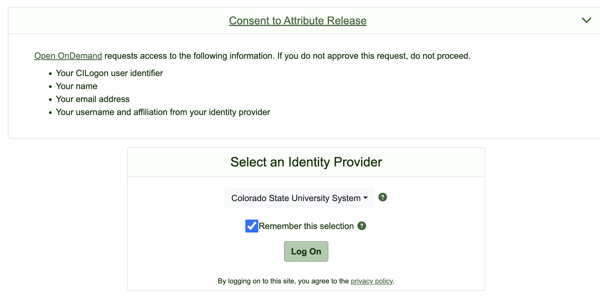
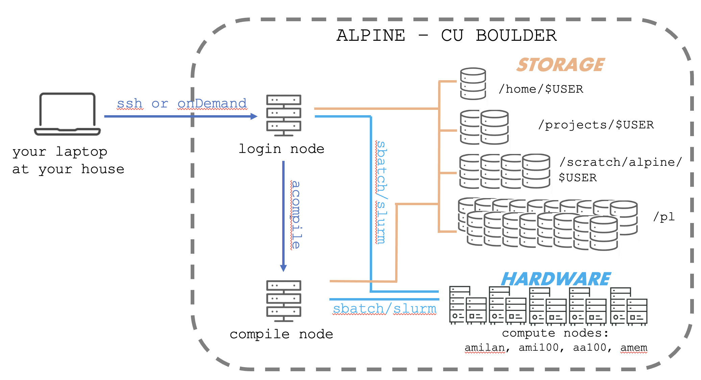
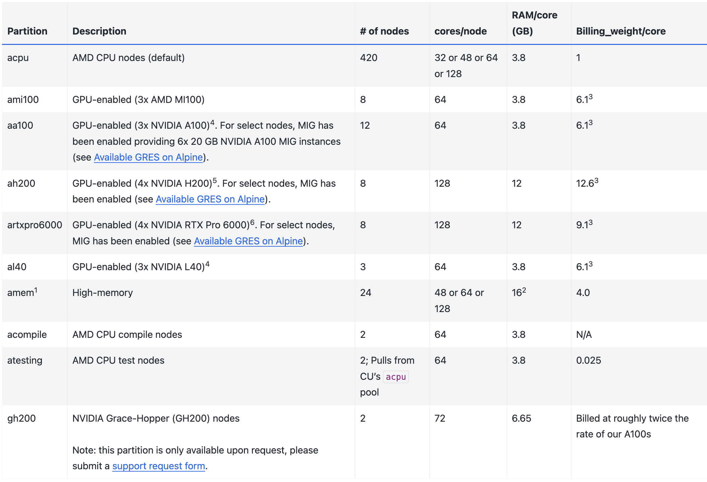
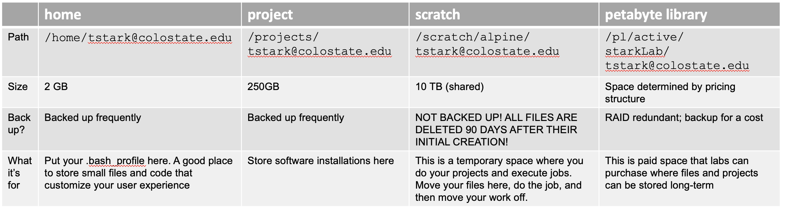

<p align="center">

</p>

# Refresher on ALPINE

We will do most of our work in this class on the ALPINE supercomputer system. We are doing this for a few reasons ...

1. Everyone will be on the same platform (no Mac v. PC issues)
2. We can do things really fast by using the power of the supercomputer system
3. You will be trained and ready to go on ALPINE for your large-scale projects!

If you took DSCI510: Linux as a Computational Platform, we introduced ALPINE here: 

  * [Connecting to Remote Computers](https://github.com/erinosb/CSU-2026FA-DSCI-510_LINUX_as_a_computational_platform/blob/main/01_modules/Week4/4-5_Connecting_to_remote_computers.md)
  * [Intro to ALPINE](https://github.com/erinosb/CSU-2026FA-DSCI-510_LINUX_as_a_computational_platform/blob/main/01_modules/Week4/4-6_Intro_to_Alpine.md)

Today, we will start to learn about **High-Performance Computing** or HPC. HPC is a means of performing large computational tasks on supercomputers or compute clusters in a way that takes advantage of their ability to perform multiple tasks simultaneously.

**Supercomputers** in the crudest terms are basically what happens if you glued 100's or 1000's of individual computers together. You end up making a giant computer with more functionality.

The supercomputer we'll be using is **ALPINE** and it lives on CU Boulder campus. [ALPINE](https://www.colorado.edu/rc/alpine) is a joint venture between Colorado State University and CU Boulder and is sponsored by those institutes and by a grant from the National Science Foundation. **ALPINE** is shared between CU Boulder, Colorado State University, CU Anschutz, and RMACC (Rocky Mountain Advanced Computing Consortium, a network of >20 other academic institutions in Colorado, Arizona, Idaho, Montana, and New Mexico).

However, please keep in mind that a supercomputer isn't required for RNA-seq data analysis. Most of these tasks can be done on a personal MAC or LINUX computer. PCs can also theoretically do the same tasks but it will be much more challenging to install the software.

Let's make sure that everyone... 

1. Is registered for ALPINE account if you haven't already
2. Can log into ALPINE using OnDemand
3. Review some concepts about ALPINE

On Thursday, we will then...

1. Review the ALPINE High Performance Compute System
2. Initiate a “conda virtual environment” where we can install RNA-seq software
3. Install software within our conda environment

-----

## Resources & References

[Overview of research computing including ALPINE](https://www.colorado.edu/rc/resources)

[ALPINE quick start guide](https://curc.readthedocs.io/en/latest/clusters/alpine/index.html)

[Please cite CURC Resources to help them maintain funding!!!](https://curc.readthedocs.io/en/latest/index.html#acknowledging-rc)

[List of upcoming workshops](https://www.colorado.edu/rc/events)

[All content from past workshops!!!](https://github.com/ResearchComputing/)

----- 

## Requesting an Alpine user account

Everyone should have an ALPINE User account, but I will keep some information here in case someone needs it.

<details>
  <summary>Click to open this section</summary>
  
If you do not have an account, please request an Alpine account at the [CU-Boulder account request page](https://rcamp.rc.colorado.edu/accounts/account-request/create/verify/csu). Follow instructions below:

  * Enter your CSU eID. This is the nickname before your @colostate.edu email.
  * Enter in your CSU eID password, a comma, and then a DUO authentication code. That is, in the password field, type your CSU NetID password, then a comma, then the word “push” or the DUO key generated by your device. For example, if your password was ilovealpine and your DUO key is 123456, you would type:

```
ilovealpine,push
```
OR
```
ilovealpine,123456
```

  * Check the box next to “I would like to run high-performance compute jobs on the RMACC Alpine Cluster” (see example below). Otherwise, you will not be added to csu-general.
  * When prompted for a description of your research, write a brief description of your own research or simply state that you are in the DSCI 512 RNA-seq course.
  * Check the box stating that you are enrolled in a course that requires access to Research Computing resources.
  * After submitting the form, you will receive an account confirmation email from CU-Boulder.
  * You're all set!

</details>

-----

## Accessing ALPINE

To log onto ALPINE, you can use the terminal command `ssh` or you can use the browser portal called **onDemand**. See below for examples of both!

----

## Accessing ALPINE using ssh


We are going to log into ALPINE using OnDemand, but I will keep some information here on logging into ALPINE via `ssh` in case this is helpful as a reference:

<details>
  <summary>Click to open this section</summary>

You can log into ALPINE using `ssh` in your own terminal window like so:
 
```
$ssh -l loki@colostate.edu login.rc.colorado.edu
Password: godofmischief,push
# Switch to your DUO app on your phone to approve
```

>[!WARNING]
> That's a lower case "L"**

>[!TIP]
> Replace your eID e-mail with loki@colostate.edu**

>[!TIP]
> You won't see anything pop up when you type your password

>[!TIP]
> If `,push` doesnt work, try `,phone` or the 6-digit code on your DUO app (refreshes every 20 seconds)**


</details>

----

## Accessing ALPINE using OnDemand

The team at CU Boulder who developed ALPINE have helped to create an alternative way to interact with the ALPINE Supercomputer, one that can happen in you internet browser like Chrome or Firefox. This method of accessing ALPINE is called OnDemand.

:hammer_and_wrench: **Group Exercise:** Let's practice accessing ALPINE using **OnDemand** together.

- Navigate to [OnDemand](https://ondemand-rmacc.rc.colorado.edu/) in a new tab or window
  - For me, I right click on the above link and select **Open Link in New Window**
  - You will be asked to select an identity provider using a pull-down menu. Select on the pull-down menu (it may say **ORCID**). Start typing **Colorado State University**. Click on **Remember** and log in. It should look like this

<p align="center">

</p>

Next steps:
- Log into your CSU NET ID. You will receive a DUO PUSH on your phone. Accept it.
- To access the LINUX command line on ALPINE, go to the **Clusters** menu. Select **>_Alpine Shell**
- In another window, you can also access your files by going to the **Files** menu and selecting any available directories.


---

## The ALPINE System - Mapped out

This is what ALPINE looks like mapped out:

<p align="center">

</p>

Just like your local computer, the ALPINE supercomputer is comprised of **computing hardware** (CPUs, GPUs, etc), memory, and **file storage space**.

When we log into ALPINE through ssh or onDemand, we don't immediately have access to all the parts of the ALPINE hardware. Instead, we arrive at the login node. The name of the login node is written right prior to the prompt. Typing `hostname` also gives you the name of the login node.


:hammer_and_wrench: **Group Exercise:** type `hostname`

---

## The Nodes

Detailed descriptions of [nodes](https://curc.readthedocs.io/en/latest/compute/node-types.html)

Nodes are spaces on Alpine where you can do tasks and execute jobs. Each node type has a designated purpose. Part of your job will be to learn what is appropriate behavior on the different types of nodes. We will learn about the **login nodes**, the **compile nodes**, and the **compute nodes**.

### Login nodes

When you first log into Alpine using `ssh`, you will be on a **login node**. Think of this as a lobby of a hotel. This is where you arrive first. You can do things like move and copy files, edit scripts, and execute small tasks. You should not run large jobs in the login node. You should not install software when you are here.

### Compile nodes

To move to a compile node, use the command `acompile`.

:hammer_and_wrench: **Try it** Switch over to a compile node like so …

```
$ hostname
$ acompile
$ hostname
```

When on a compile node, we can load existing software, install new software, run small jobs, and send big jobs to the compute nodes.

Let's see what software is available to load:


:hammer_and_wrench: **Try it** 

```
$ module avail
```

### Compute nodes

**Compute notes** are the most numerous nodes on the system. There are roughly 420 regular compute nodes on the ALPINE system and a growing number of specialized ones. The compute nodes are where big jobs will run.

To run jobs on compute notes, we will need to get in line by requesting a job through a process called **batch submission**. Depending on how many users there are and what types of jobs have already been requested to run, we will be assigned to different compute nodes when they become available. The batch submission software used by ALPINE is called **SLURM** and the main command we use is `sbatch`.

Compute nodes are **multi-core processors**. This means we can run multiple jobs on one node. In the ALPINE architecture, we will mostly be using the **AMD milan** compute nodes (called `acpu`) which have can run up to 128 jobs simultaneously. Users can also request multiple nodes, too.

Here is an outline of the different types of compute nodes available:

<p align="center">

</p>

----

## Jupyter Session

Another way of using compute nodes is to open a Jupyter Notebook.

Quick demonstration of a Jupyter Session

 - For detailed information see the [CURC Jupyter Session Guide](https://curc.readthedocs.io/en/latest/open_ondemand/jupyter_session.html)


:hammer_and_wrench: **Group Exercise:** Open a Jupyter Session

----

## Alpine File Storage

Detailed information about the [File Storage on Alpine](https://curc.readthedocs.io/en/latest/compute/filesystems.html)

Whereas the nodes are analogous to CPU and memory on your home laptop, the filesystem is analogous to your hard drive. This is where data will be stored. The ALPINE team has pre-organized several nice directories where each user can house their data. Each space has a designated purpose.

Here are the different file storage spaces available:

<p align="center">

</p>

## Software 

We have two methods for installing software on ALPINE:
- **Module system** - The Research Computing team has already installed some software for us. We just need to select it using the module system.
- **conda** - Alternatively, we can install virtual enrivonments. These are spaces where multiple software can be downloaded and installed. Each time we log into ALPINE, we'll enter one of these environments. Different users can create different environments for different research projects and toggle between them.

Continue on to [Intro to RNAseq](1-3_Intro_to_RNAseq.md)
