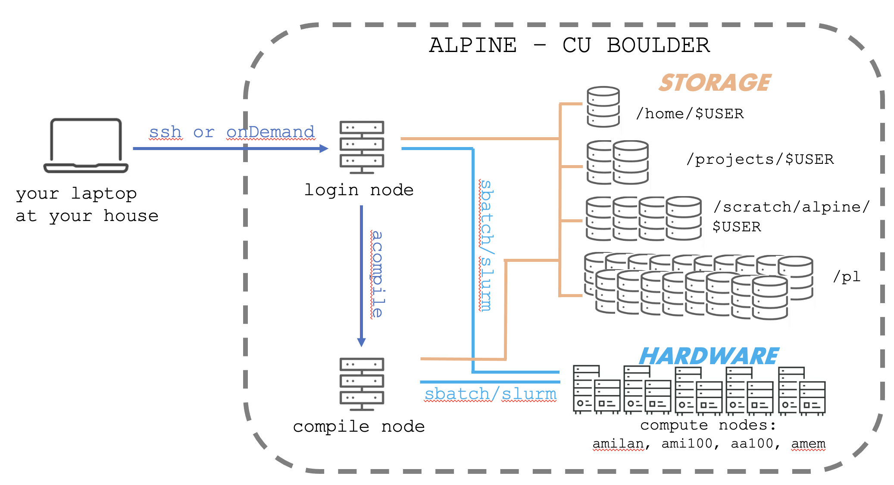

<p align="center">

</p>

# Installing Software on ALPINE

We will explore two ways to access software on ALPINE. The first is the [modules system](https://curc.readthedocs.io/en/latest/compute/modules.html). This will allow us to use software that the Research Computing team has already pre-installed and configured for us.

The second is through creation of a custom **Anaconda environment**. This will allow us to create a full environment of software we will use for this class. **Conda** is the open-source, cross-platform package and environment managment system used to create custom Anaconda environments. Similarly, we also commonly use **mamba**. mamba is a reimpliment of the conda package manager in C++ designed for speed and efficiency. Mamba offers the same environment management capabilities, including creation and managament of isolated environments. 

Here are the software packages we'll need for this class and how we'll install each:

| Software Package  | What it does | How we'll install it |
|-------------------|--------------|----------------------|
| sra-toolkit | downloads genomics data from online databases	 | modules |
| ncbi-datasets-cli | downloads genomes and .gtf files from online databases | conda |
| fastp | quality control | conda |
| bwa (bowtie) | alignment | conda |
| hisat2 | alignment | conda |
| bedtools | genomics file conversion | conda |
| samtools | genomics file conversion | conda |
| subread | tabulation | conda |
| deeptools | heatmaps & file conversion | conda |

**Modules** software has been pre-installed by the CURC personnel. Sometimes they need to do this because there are extra administration steps that need to happen only from the "back end". 

**Conda environments** are collections or **enrivonrments** of software that you, the user, will install yourself.

>[!NOTE]
> If you try to install software and it doesn't work, please contact CURC personnel. They may need to install it as a module for it to work on the system.

**How do I start using the software?**

  * Unlike on your own personal laptop, software installation on an HPC system is a two step process
  * **Initial install** - this happens first. For modules, the CURC personnel have already done it. For conda environments, we will do this together.
    * Only have to do this once.
  * **Loading or activating**. 
    * Software that is installed using the "modules" feature must be **loaded** every session and done so individually.
    * Conda environments will be **activated** every session, but will turn on all the software as a group.

----

# Resources

- [Loading Modules](https://curc.readthedocs.io/en/latest/compute/modules.html)
- [Research Computing](https://curc.readthedocs.io/en/latest/software/python.html#basic-conda-commands-to-get-you-started)
- [Anaconda Resources](https://docs.conda.io/projects/conda/en/latest/user-guide/tasks/manage-environments.html)
- [bioconda](https://bioconda.github.io/index.html)

----

# Log into ALPINE through OnDemand

For this course, we will access ALPINE through a web browser portal called OnDemand.

Let's log into ALPINE using [OnDemand](https://curc.readthedocs.io/en/latest/open_ondemand/index.html). 
- Open https://ondemand-rmacc.rc.colorado.edu in a new tab or window
- Log into your CSU NET ID. You will receive a DUO PUSH on your phone. Accept it.
- To access the LINUX command line on ALPINE, go to the Clusters menu. Select >_Alpine Shell

----

# Loading Modules

Here, I will show you how to load a module. 


First, let's orient where we are ...
```
$ whoami
$ hostname
$ pwd
$ curc-quota 
```

`curc-quota` should give you your disk usage. 

Here is the “map” of ALPINE for reference.

<p align="center">

</p>

Now move to the compile node!
```
$ acompile
$ hostname
```

> [!NOTE]
> You will get booted off the acompile node after one hour. Use $ acompile --time=3:00:00 to specify you want 3 hours of time.

  * From here, we can see what modules we have loaded already: 

```
$ module list
```
 
   * Looks like very little

Next, lets see what modules are pre-installed by the staff and available to load: 

```
$ module avail
```

> [!NOTE]
> All the modules are on acompile. If you try to look through the module avail list on the login node, you won't see anything.

## Quick modules demo using cellranger

Here are some common modules commands:

```bash
module avail                     # see what modules are pre-installed and available to load
module load <name_of_module>     # load the module
module unload <name_of_module>   # unload a module
module list                      # see what modules are currentl loaded
```

Let's test this out with the module `cellranger`

```bash

$ cellranger    # command not found

$ module list   # cellranger is not installed

$ module avail  # find cellranger listed as installed as an option to load

$ module load cellranger    # load cell ranger

$ module list    # see it listed now!

$ cellranger 

$ cellranger --version

$ module unload cellranger    # unload
```


The one we want is `sra-toolkit/3.0.0`. To load it, do the following: 

```
$ module load sra-toolkit
```

**!!! Quick Tip:** Don't forget to use TAB autocomplete. 

Now, when you load sra-toolkit for the first time you should see a message: `The first time you use SRA Toolkit you will need to configure it by running "vdb-config -i".
Please see CURC documentation for more information about configuring and running SRA Toolkit.`

We will do this later, skip for now!

Let's test if it is installed properly. One of the commands in the sra-toolkit package is `fasterq-dump`
```
$ fasterq-dump
```

If you received `command not found` sra-toolkit is NOT installed

If you received a printout of instructions, sra-toolkit IS installed

**!!! Quick Tip:** for working with modules

```
$ module spider <module>      # If you cannot load a module because of dependencies, you can use the module spider to find what dependencies you need to load the module.
$ module spider <module>      # Searches for a particular software
$ module spider python        # note there are multiple versions you could choose
$ module unload <modulename>  # uninstall a module
$ module purge                # uninstall all modules
```

## Initiate a virtual conda environment 

Another way of installing software is through a **conda virtual environment**. Virtual environments can contain their own combinations of installed software of different versions. In this way, you can switch between different environments for different projects. This is one of the many ways the community is trying to make research more **reproducible**.

**!!! Exercise:** We first need to set up a configuration file in our home directory. We will start a new configuration file specifically for the conda software. This will tell conda where to save and install programs.

Follow along with these steps:

Ensure you are on a compile node
```
$ hostname
```

If you see anything with 'login', execute
``` 
$ acompile
```

See if you are not in your home directory
``` 
$ pwd 
```

If you are not in your home directory, use the `cd` command with no argument to go there.
```
$ cd 
```
 
Now, let's look and see if you already have a `.condarc` file. Some of you may
```
$ ls -alh
```

If you have a `.condarc` file, just look inside of it with `more` or `head` and see what it says.

If you do not have a `.condarc`, file, let's make one
```
$ pwd # make double triple sure you're in your home directory or this won't work
$ nano .condarc
```

Now copy and paste the following code into your file
```
pkgs_dirs:
  - /projects/$USER/.conda_pkgs
envs_dirs:
  - /projects/$USER/software/anaconda/envs
 
# Exit out of nano using
# CTRL + X
# Type Y
# Return
 
$ more .condarc     # do this to check your .condarc file
```

Yay! If you now have a `.condarc` file and see the four lines of code within it specifying your package and environmental paths, you are good to go! You won't need to do this step again on ALPINE.

**!!! Exercise:** Next, we will activate and explore **conda**. 

Conda is a module. To activate conda, use the `module load` command
```
$ hostname # double check you're on a compile node
$ module avail
$ module load anaconda
```

We can list all the virtual conda environments we can currently load
```
$ conda env list

# conda environments:
#
base                   *  /curc/sw/anaconda3/2023.09
ATOC_NWP                 /curc/sw/anaconda3/2023.09/envs/ATOC_NWP
bash_spr23               /curc/sw/anaconda3/2023.09/envs/bash_spr23
pyomp_2022               /curc/sw/anaconda3/2023.09/envs/pyomp_2022
synoptic_f23             /curc/sw/anaconda3/2023.09/envs/synoptic_f23
DSCI510                  /projects/.colostate.edu/jesshill/software/anaconda/envs/DSCI510
FuSeq                    /projects/.colostate.edu/jesshill/software/anaconda/envs/FuSeq
Picard                   /projects/.colostate.edu/jesshill/software/anaconda/envs/Picard
RNAseq                   /projects/.colostate.edu/jesshill/software/anaconda/envs/RNAseq
py3.7                    /projects/.colostate.edu/jesshill/software/anaconda/envs/py3.7
scRNAseq                 /projects/.colostate.edu/jesshill/software/anaconda/envs/scRNAseq
                         /projects/jesshill@colostate.edu/software/anaconda/envs/DSCI510
                         /projects/jesshill@colostate.edu/software/anaconda/envs/RNAseq
                         /projects/jesshill@colostate.edu/software/anaconda/envs/py3.7
```

The output shows us the default environments that the personnel at CU Boulder have kindly initiated for us to use. It also shows us the environments that we have created. The one we are currently using is marked by an asterisk. Note also, that **(base)** shows up before your prompt... another indication that conda is active and working. 

**!!! Exercise:** Lets build our own custome environment

We want to build a custom virtual environment for this class. To do so...
```
$ hostname      # Ensure first that you're on a compile node.
$ conda create -n 2026dsci python=3.11 # we need this version of python for deeptools and hisat2-inspect to work
 
# You will be asked if you want to proceed. Type y
# When your environment is created, check that it exists:
 
# Check it
$ conda env list
```

You should now see a new virtual environment has appeared called `2026dsci`

To navigate into your new environment, do this
```
$ conda activate 2026dsci
$ conda env list # This shows you which environments are available and selected
$ conda list  # This shows the software currently installed in your active environment
 
# Another key you're on the right track... Your prompt should now start with your conda environment when active
(2026dsci) [jesshill@colostate.edu@c3cpu-a2-u32-1 ~]$ 
```

Yay! You should now have your environment `2026dsci` installed and activated. 

**!!! Exercise:** Let's install software! For this class, we will need the software packages: `fastp` `bwa` `hisat2` `bedtools` `samtools` `subread` `deeptools`

```
# First double, triple check that you're in the 2026dsci environment
$ conda env list #Is it starred?

# To try and install all of the pieces of software at once do the following, however this doesnt always work and they often have to be installed individually. Try anyway. 
$ conda install -c bioconda fastp bwa hisat2 bedtools samtools subread deeptools 
 
# You may need to press y to install dependencies. Type "y"
# Some things will say they are failing. That's ok. 
# It will suggest you update conda. Ignore that.
# This whole install took ~20 minutes for me
```

**NOTE:** If you see a KILLED message and it looks like it stopped installing, try installing the software one at a time. I usually run into trouble when I try to install mulitiple packages at once! 

Now, let's test and see whether the software you requested was installed successfully. If they weren't installed successfully, you will get an error message. 
```
$ fastp
$ bwa
$ hisat2       #Note: hisat2 will say Error at the bottom because you didn't give it a sequence file. That's ok.
$ bedtools
$ samtools
$ featureCounts
$ bamCoverage -h
```

Yay! You have successfully installed and activated your conda environement!

## Summary of Conda 

To summarize, we configured our system to install our software in projects. We only need to do that once.

We also created an environment to use in this class. Again, this is something we just do once.

What will we need do we need to do routinely?

Next time you log into ALPINE, You'll do the following tasks:
1. Switch to the compile node
2. Load the anaconda module
3. Activate your 2026dsci environment

```
$ acompile
$ module load anaconda
$ conda activate 2026dsci
```

What if you want to load more software into this environment?

Use bioconda or conda 
```
$ conda install -c bioconda <SOFTWARE1> <SOFTWARE2>
#OR
$ conda install -c <SOFTWARE1> <SOFTWARE2>
```

Just make sure you are actively in the environment when you are installing new stuff!

## Resources 

- For more information: [Installing software](https://curc.readthedocs.io/en/latest/software/python.html)
- For a list of all avialable bioconda software: [Bioconda](https://bioconda.github.io/conda-package_index.html)
- For a list of all availble conda software: [Anaconda](https://anaconda.org/anaconda/repo)


Continue on to [RNAseq best practices](1-6_241107_RNAseqBestPractices.pdf)
