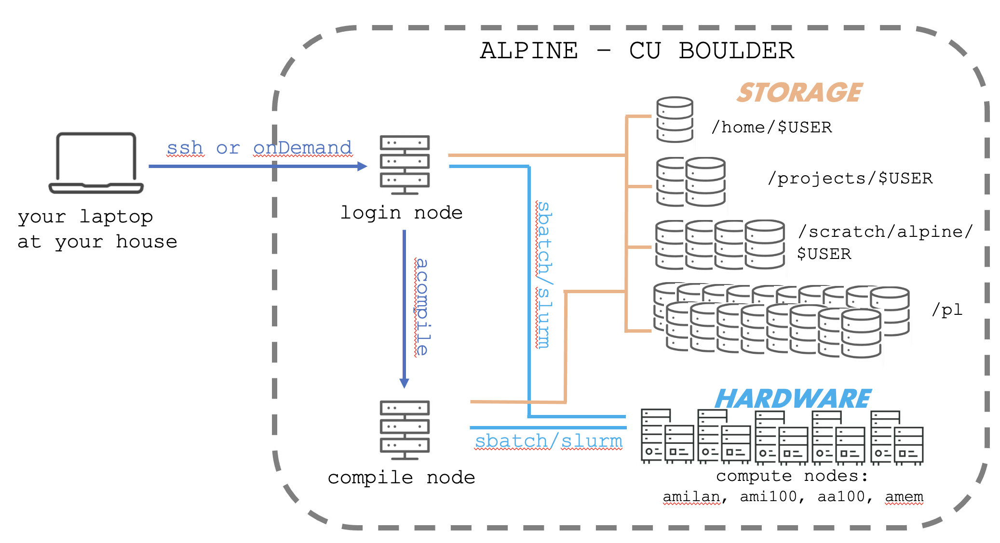
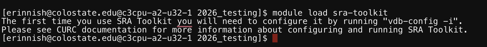

<p align="center">

</p>

# Thursday, November 12, 2026

  * Announcement - Friday 9 am - 10 am, AZ E210 - Study Group
  * Wednesdays - ALPINE is typically down

# Learning objectives for today

  * Gain more practice on ALPINE to familiarize yourself with basic navigation, notes, and storage spaces
  * Become knowledgeable of the two ways to load software on ALPINE 1) Modules and 2) conda
    * Modules are installed by CURC staff
    * Modules must be loaded by the user each session
    * Conda environments are developed by the user (typically once)
    * Conda environments must be activated each session
  * Learn terminology for RNA-seq experiments: sample, replicate, biological replicate, technical replicate, conditions
  * Learn best practices for designing RNA-seq experiments around a biological question
  * Learn best practices for interpreting RNA-seq experiments keeping in mind the limitations of each study
  * Understand that the experiment you do AFTER RNA-seq are very important! Test your ideas and results!

------

# Installing Software on ALPINE

We will explore two ways to access software on ALPINE. The first is the [modules system](https://curc.readthedocs.io/en/latest/compute/modules.html). This will allow us to use software that the Research Computing team has already pre-installed and configured for us.

The second is through creation of a custom **Anaconda environment**. This will allow us to create a full environment of software we will use for this class. **Conda** is the open-source, cross-platform package and environment managment system used to create custom Anaconda environments. Similarly, we also commonly use **mamba**. mamba is a reimpliment of the conda package manager in C++ designed for speed and efficiency. Mamba offers the same environment management capabilities, including creation and managament of isolated environments. 

Here are the software packages we'll need for this class and how we'll install each:

| Software Package  | What it does | How we'll install it |
|-------------------|--------------|----------------------|
| sra-toolkit | downloads genomics data from online databases	 | modules |
| ncbi-datasets-cli | downloads genomes and .gtf files from online databases | conda |
| fastp | quality control | conda |
| bwa (bowtie) | alignment | conda |
| hisat2 | alignment | conda |
| bedtools | genomics file conversion | conda |
| samtools | genomics file conversion | conda |
| subread | tabulation | conda |
| deeptools | heatmaps & file conversion | conda |

**Modules** software has been pre-installed by the CURC personnel. Sometimes they need to do this because there are extra administration steps that need to happen only from the "back end". 

**Conda environments** are collections or **environments** of software that you, the user, will install yourself.

>[!NOTE]
> If you try to install software and it doesn't work, please contact CURC personnel. They may need to install it as a module for it to work on the system.

**How do I start using the software?**

  * Unlike on your own personal laptop, software installation on an HPC system is a two step process
  * **Initial install** - this happens first. For modules, the CURC personnel have already done it. For conda environments, we will do this together.
    * Only have to do this once.
  * **Loading or activating**
    * Software that is installed using the "modules" feature must be **loaded** every session and done so individually.
    * Conda environments will be **activated** every session, but will turn on all the software as a group.

----

# Resources

- [Loading Modules](https://curc.readthedocs.io/en/latest/compute/modules.html)
- [Research Computing](https://curc.readthedocs.io/en/latest/software/python.html#basic-conda-commands-to-get-you-started)

----

## Log into ALPINE through OnDemand

For this course, we will access ALPINE through a web browser portal called OnDemand.

Let's log into ALPINE using [OnDemand](https://curc.readthedocs.io/en/latest/open_ondemand/index.html). 
- Open https://ondemand-rmacc.rc.colorado.edu in a new tab or window
- Log into your CSU NET ID. You will receive a DUO PUSH on your phone. Accept it.
- To access the LINUX command line on ALPINE, go to the Clusters menu. Select >_Alpine Shell

Next, move to the acompile node where we will install software:

```bash
acompile --time=03:00:00
```


----

# Software - Loading Modules

Here, I will show you how to load a module. 

First, let's orient where we are ...

```bash
whoami
hostname
pwd
curc-quota 
```

`curc-quota` should give you your disk usage. 

Here is the “map” of ALPINE for reference.

<p align="center">

</p>

Now move to the compile node!

```bash
acompile
hostname
```

> [!NOTE]
> You will get booted off the acompile node after one hour. Use $ acompile --time=3:00:00 to specify you want 3 hours of time.

  * From here, we can see what modules we have loaded already: 

```bash
$ module list
```
 
   * Looks like very little

Next, lets see what modules are pre-installed by the staff and available to load: 

```bash
module avail
```

> [!NOTE]
> All the modules are on acompile. If you try to look through the module avail list on the login node, you won't see anything.

## Quick modules demo using cellranger

Here are some common modules commands:

```bash
module avail                     # see what modules are pre-installed and available to load
module load <name_of_module>     # load the module
module unload <name_of_module>   # unload a module
module list                      # see what modules are currentl loaded
```

Let's test this out with the module `cellranger`

```bash
cellranger    # command not found
module list   # cellranger is not installed
module avail  # find cellranger listed as installed as an option to load
module load cellranger    # load cell ranger
module list    # see it listed now!
cellranger 
cellranger --version
module unload cellranger    # unload
```

----

## Configuring The SRA-Toolkit Module - First Time Usage

**SRA Toolkit** is software that will allow us to download deposited RNA-seq data from repositories like NCBI GEO and the SRA (Short Read Archive) Database. 

Unlike cellranger, SRA Toolkit needs a one-time configuration step before we can use it. 

Basically, we need to tell the software which directory we want to use as a temporary location for downloading big or fragmented pieces of sequence data. 

First, to get started, let's **load** the SRA Toolkit module:

```bash
module avail # Look for sra-toolkit
```

The one we want is `sra-toolkit/3.0.0`. To load it, do the following: 

```bash
module load sra-toolkit
```

> [!TIP]
> Don't forget to use TAB autocomplete. 

Every time you load SRA Toolkit, CURC will warn you that it needs to be properly configured prior to use: 

<p align="center">

</p>

Let's test if it is installed properly. One of the commands in the sra-toolkit package is `fasterq-dump`

```bash
fasterq-dump
```

If you received `command not found` SRA Toolkit is NOT installed

If you received a printout of instructions, SRA Toolkit IS installed

Looking back at the warning message that was printed out, it instructs us to set up this module by reading the instructions here:

[CURC Instructions SRA-Toolkit](https://curc.readthedocs.io/en/latest/software/sratoolkit.html)

> [!NOTE]
> At this point, we will switch over to the CURC instruction link above and follow their instructions

Briefly, this will involve the following steps:

  * creating a sra directory where we can store temp and cache files
  * open up the vdg config applet
  * specifying the pathway to our sra directory
  * saving and closing

Now, let's check whether SRA Toolkit works now:

```bash
fasterq-dump
```

If it works, you should see a usage page with instructions.

Did it work? Is it installed?

-----

# Summary of Modules

**To summarize:**

  * To use pre-installed modules, just do the following each time:
    * Move to acompile
    * `module avail`
    * `module load <your module name>`
  * Most modules just work right away. Some need to be configured

> [!TIP] 
> Here are some useful commands for modules

```bash
module avail                # which modules are available?
module list                 # which modules have you already loaded?
module load <module>        # load a module
module spider <module>      # If you cannot load a module because of dependencies, you can use the module spider to find what dependencies you need to load the module.
module spider <module>      # Searches for a particular software
module spider python        # note there are multiple versions you could choose
module unload <module>      # uninstall a module
module purge                # uninstall all modules
```

Continue on to [Installing Software 2 - conda](1-6_Installing_software_conda.md)
