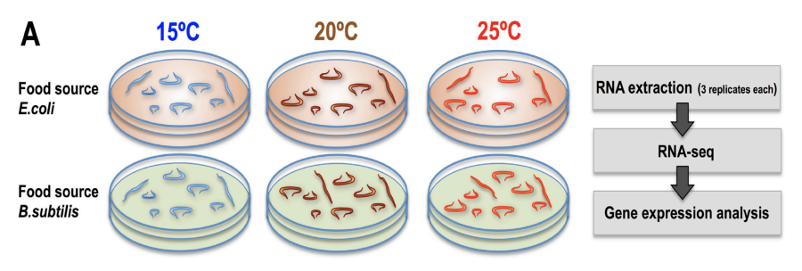
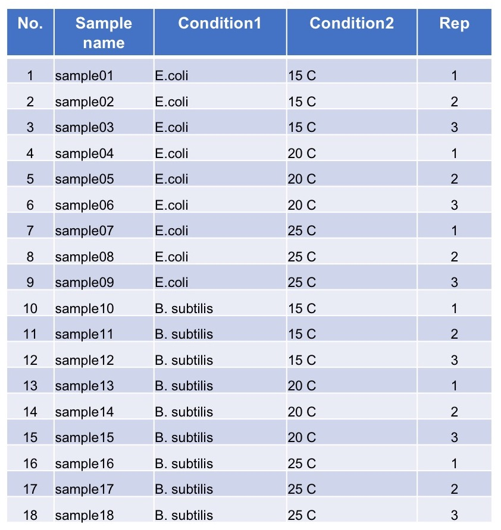

# Tuesday, November 17, 2026

  * Quiz - in class
  * Homework 1 & Reading 1 due today

-----

# Learning Objectives for Today:

  * Know key principles of large project organization
  * Be familiar with the best practices for documentation and record keeping
  * Gain familiarity with Job Submission on an HPC system
  * Understand that genomics data repositories archive data
  * Learn how to download datasets from the Short Read Archive

-----

# The Project 

We will use one RNA-seq experiment and its dataset as an example in this class. We will download the raw sequence reads from this dataset and analyze them using our RNA-seq Analysis Pipeline. Today, we will learn about the dataset and obtain its raw sequence reads. Tuesday, we will learn more details about the the RNA-seq Analysis Pipeline.

[Gómez-Orte, et al., (2017) Effect of the diet type and temperature on the C. elegans transcriptome. Oncotarget. 2018 Feb 9; 9(11): 9556–9571.](https://pmc.ncbi.nlm.nih.gov/articles/PMC5839384/)

"The transcriptomes of model organisms have been defined under specific laboratory growth conditions. The **standard protocol for Caenorhabditis elegans growth and maintenance is 20°C on an Escherichia coli diet**. Temperatures ranging from 15°C to 25°C or feeding with other species of bacteria are considered physiological conditions, but the effect of these conditions on the worm transcriptome has not been well characterized. Here, **we compare the global gene expression profile for the reference Caenorhabditis elegans strain (N2) grown at 15°C, 20°C, and 25°C on two different diets, Escherichia coli and Bacillus subtilis**."

## General data structure of the project: 

## Questions and hypotheses

  * Does diet or temperature have a greater impact on the transcriptome? 
  * What types of pathways change when diet is altered?
  * What types of pathways change when temperature is altered?

Continue on to [Project Initiation](2-2_Project_Initiation.md)
