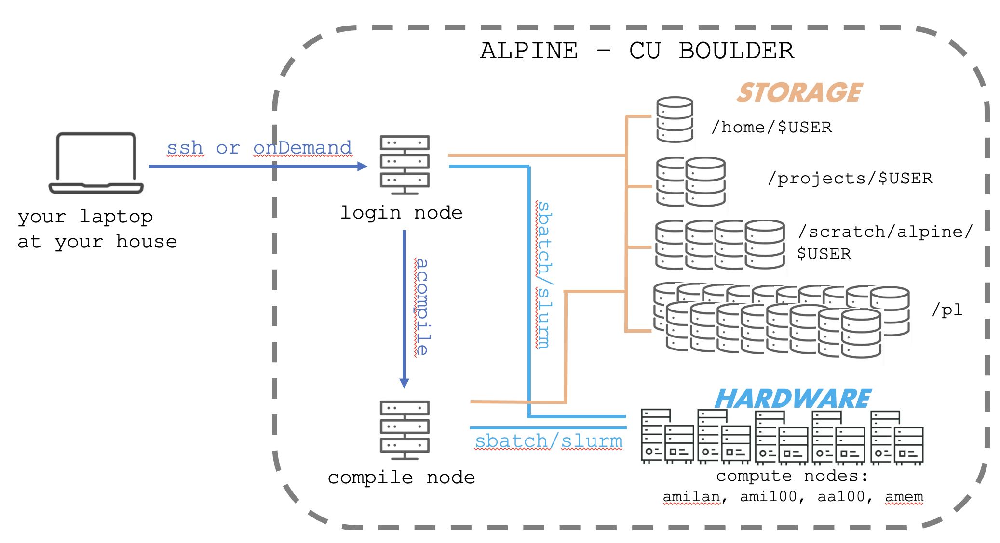
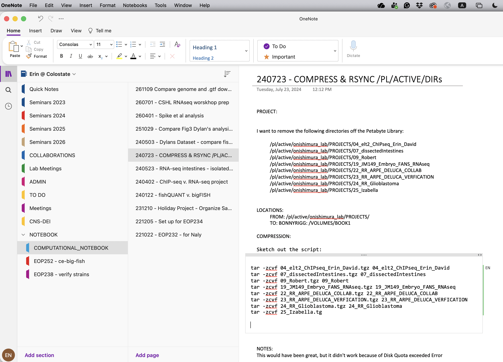

<p align="center">

</p>

# Project Initation

We will now start a project to analyze the Gomez-Orte RNA-seq data.

----

## Resources

[Ten Simple Rules for Defining a Computational Biology Project](https://journals.plos.org/ploscompbiol/article?id=10.1371/journal.pcbi.1003285)

[Ten Simple Rules for Reproducible Computational Research](https://journals.plos.org/ploscompbiol/article?id=10.1371/journal.pcbi.1003285)

----

## Step 1. Log onto ALPINE and activate conda environment 

:hammer_and_wrench: **GROUP EXERCISE** Try doing the following steps independently.

  1. Login to ALPINE through [OnDemand](https://ondemand-rmacc.rc.colorado.edu/) 
  2. Open a Terminal by clicking **CLUSTERS** -> **>_Alpine Shell Access** 
  3. Move to the compile node
  4. Load the `sra-toolkit` module
  5. Load the `anaconda` module
  6. Activate your `2026dsci` environment

<details>
  <summary>For details and tips click here</summary>

```bash
# Move to the compile node
acompile

# Load required modules
module avail
module load sra-toolkit
module load anaconda
module list

# Activate conda environment
conda activate 2026dsci
```

</details>

----

## Step 2. Start a Project Directory

We will start a project directory and perform all our analytical steps within that directory.

Currently, we are in our home directory. Tony Stark's would looks like this: `/home/tstark@colostate.edu/`.

Review the ALPINE architecture: 

<p align="center">

</p>


Review the file storage spaces available:

<p align="center">

</p>

We will be using our scratch space to perform the projects in this class. That means, everything we do will be deleted 90 days from now!

:hammer_and_wrench: **GROUP EXERCISE** Let's start our directory

```bash
# Go to your scratch directory.
$ cd /scratch/alpine/<eID>@colostate.edu   # Substitute <eID> with your eID
 
# Create a directory for this class. Call it DSCI512
$ mkdir DSCI512
 
# Move into that directory
$ cd DSCI512
 
# Within that directory start a new project
$ mkdir PROJ01_GomezOrte
 
# Move into that directory
$ cd PROJ01_GomezOrte
 
# Create three new subdirectories as follows
$ mkdir 01_input 02_scripts 03_output
```

:smile: **YAY!** Now we have a place to do our work!

----

## Step 3. Write it down

:pencil2: **Best Practice**

  * Nothing inspires amnesia like computational biology
  * You will do similar tasks multiple times
  * You will not remember what you did unless you actually write it down

<p align="center">
<br>
<sub><b>Example:</b>Computational Lab Notebook on OneNote</sub>
</p>
  

:pencil2: **Different Computational Notebook Approaches:**

  * Physical notebook
  * Microsoft OneNote (shareable with your trainees and mentors)
  * Electronic Lab Notebook (ELN) system such as LabArchives, Benchling
  * Your computational notebook should be SEPARATE from your project directory

:pencil2: **What to write down?**

  * Write down the MINIMUM in your computational notebook
  * Date
  * Goal
  * Platform & Directory (ALPINE & Dir, or LAPTOP & Dir)
  * Did it work? 
  * What you want to do next?
  * Write down the MAXIMUM in your project directory (automated)

:hammer_and_wrench: **GROUP EXERCISE** Start a Computational Notebook 

  * Start your first entry. 

:hammer_and_wrench: **GROUP EXERCISE** Start a README File. 

  * Within the project folder, start a file called `README.txt` and write a brief description of your project

> [!TIP]
> Try to standardize how you format things in your written notes. ENP_01, ENP_02, ENP_03 for projects; 20261115 for dates; choose standardized, searchable, sortable names. 

Continue on to [Running Jobs with SLURM](2-3_Running_Jobs_with_SLURM.md)
