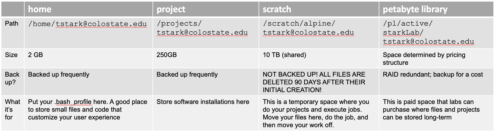

<p align="center">

</p>

# Project Initation

We will now start a project. Quick review of some aspects of the ALPINE architecture.

## Start an RNA-seq data directory

We will start a data analysis directory for this class and initiate a project within that directory.

Currently, we are in our home directory `/home/erinnish@colostate.edu/`. The ALPINE staff have set up directories for each user. Let's review the general ALPINE Architecture:

### The Alpine System: 

<p align="center">

</p>

### Alpine File Storage: 

[Detailed information about the file storage on ALPINE](https://curc.readthedocs.io/en/latest/compute/filesystems.html)

Whereas the nodes are analogous to CPU and memory on your home laptop, the filesystem is analogous to your hard drive. This is where data will be stored. The ALPINE team has pre-organized several nice directories where each user can house their data. Each space has a designated purpose.

Here are the different file storage spaces available:

<p align="center">

</p>

:hammer_and_wrench: Let's start our project

We will be using our scratch space to perform the projects in this class. That means, everything we do will be deleted 90 days from now!

```
# Go to your scratch directory.
$ cd /scratch/alpine/<eID>@colostate.edu   # Substitute <eID> with your eID
 
# Create a directory for this class. Call it **DSCI512**
$ mkdir DSCI512
 
# Move into that directory
$ cd DSCI512
 
# Within that directory start a new project
$ mkdir PROJ01_GomezOrte
 
# Move into that directory
$ cd PROJ01_GomezOrte
 
# Create three new subdirectories as follows
$ mkdir 01_input 02_scripts 03_output
```

**YAY!** Now we have a place to do our work!

## Best Practices: write it down


Continue on to [Running Jobs with SLURM](2_4_Running_Jobs_with_SLURM.md)
