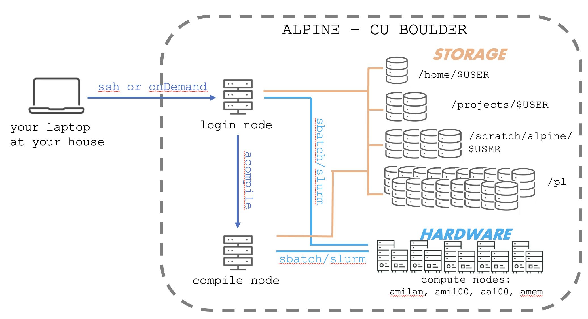

<p align="center">

</p>

# Overview of Running Jobs with SLURM 

## Resources

- Research Computing at Boulder - [Guide to running batch jobs](https://curc.readthedocs.io/en/latest/running-jobs/batch-jobs.html)
- Research Computing at Boulder - [Guide to SLRUM directives](https://curc.readthedocs.io/en/latest/running-jobs/job-resources.html)
- Research Computing at Boulder - [Alpine Hardware](https://curc.readthedocs.io/en/latest/clusters/alpine/alpine-hardware.html)
- SCHEDMD - [Guide to SLURM](https://slurm.schedmd.com/reservations.html#:~:text=Reservation%20Use&text=This%20name%20is%20automatically%20generated,completely%20within%20the%20named%20reservation.)

## A review of vocabulary words

- **High-Performance Computing (HPC):** this is the field of computing that uses **supercomputers**, **compute clusters**, or **servers** to solve computational tasks. It is most often used in STEM research fields but has also expanded to business and industry fields.
- **Supercomputers** and **compute clusters** are both architectures of computers in which multiple, small computers are stitched together so they function as a single, big computer. They differ in their scale, with the supercomputer term being used for larger systems.
- **Servers:** this is another catch-all term that can also refer to a compute cluster (of varying sizes, some are small) but implies that the system is hosting some function for users.
- **Nodes** are the individual, small computing units of which a supercomputer is comprised. Individual nodes are like mini-computers, each with its own CPUs, memory, and a bit of storage space.
  - **Login Node**
  - **Compile Node**
  - **Types of Compute Nodes:** Compute nodes are the nodes on the ALPINE system where we run jobs. They come in a few different types: **GPU** (graphical processing units), **HighMEM** (high memory nodes), and **AMD CPUs** (typical, garden-variety, CPU). There are currently 424 AMD CPUs
  - **Node design:** Each compute node can support multiple tasks. These tasks are referred to as either **processes** or **threads** or **cores**. This is similar to having a quad-CPU in your laptop that can support 4x processes at a time. Most AMD CPU Nodes on ALPINE can support between 32 - 64 processes, and 33 of them can support 128 processes at a time.

<p align="center">

</p>

----

## Best Practices

  - Don't run jobs on the **login node!**
  - **Compile nodes** are for small jobs, testing, and software installation
  - **Compute nodes** are for all your big jobs

How can we assign jobs to compute nodes?
  
  * We will use the **job scheduler** called **SLURM** to assign jobs to the compute nodes. A [job scheduler](https://en.wikipedia.org/wiki/Job_scheduler) is a specialized piece of software used in **High Performance Computing** to send jobs to specialized nodes.


----- 

<p align="center">

</p>


# Quick SLURM Overview 

**SLURM** is a software that allows multiple users to share resources. We submit jobs to slurm using **batch scripts**. Batch scripts are just specialized bash scripts that are executed using the command `sbatch`. Batch scripts do everything that bash scripts do, but in addition, **they request a certain amount of the supercomputer hardware for a certain amount of time**. 

When we execute batch scripts, they don't run right away. Instead, they get in the queue and are assigned to a node based on the requested hardware, requested time, and availability.

:hammer_and_wrench: **GROUP EXERCISE** Follow along. Let's do some SLURM practice.

- First, navigate to the space `/scratch/alpine/$USER`
- Let's make a new directory called `test_slurm`
- `cd` into the `test_slurm` sub-directory

## Running a bash script - demonstration

:eyes: **Just watch**

Imagine the script `testscript.sh`

```bash
#!/usr/bin/env bash
 
echo "hello"
sleep 30
echo "world"
sleep 30
```

This script is run with the command:

```bash
$ bash testscript.sh
```

The script prints Hello, waits 30 seconds, then prints world, then waits 30 seconds.


## Running an batch script

To run jobs using SLURM, we take a typical `.sh` script and convert it to an `.sbatch` script. To turn a bash script into an sbatch script we just need to do a few things...

1. change the file extension
2. add directives
3. execute with the command `$ sbatch <yourscript.sbatch>`

Sbatch scripts look like so...

```bash
#!/bin/usr/env bash
 
## Directives go here...
#SBATCH <SLURM commands>
#SBATCH <SLURM commands>
#SBATCH <SLURM commands>
#SBATCH <SLURM commands>
#SBATCH <SLURM commands>
#SBATCH <SLURM commands>
 
## Software is loaded here...
module purge
module load <desired software>
 
## Your regular old shell script goes here...
echo "hello"
sleep 30
echo "world"
sleep 30
```

:hammer_and_wrench: **GROUP EXERCISE** 

  * Start a script called `testscript.sbatch`
  * Open `testscript.sbatch` in a text editor
  * Copy and paste the script below

```bash
#!/usr/bin/env bash
 
#SBATCH --nodes=1
#SBATCH --ntasks=1
#SBATCH --time=0:1:30
#SBATCH --partition=acpu
#SBATCH --qos=cpu-testing
#SBATCH --output=sample-%j.out
 
## Code
echo "hello"
sleep 30
echo "world"
sleep 30
```

Submit this script to the SLURM job scheduler using this command:

```bash
$ sbatch testscript.sbatch
```

Use the following commands to interact with the progress of your script:

```bash
$ squeue -u $USER      # to see all the scripts you, the user, are running
$ sacct -u $USER       # See some stats about running or previously run jobs
$ sacct -X --format JobID,JobName,AllocCPUS,State,ExitCode,Elapsed,TimeLimit,Submit,Start,End  # A nicely formatted status output
$ scancel <jobID#>     # to cancel a script
```

Do you see a log files that were created? Peek into them. Do you see .fastq files?

:question: What just happened? 

:question: What do all the #SBATCH lines mean? 

Everything after an `#SBATCH` is a **SLURM directive**. Think of these like **options**. You're telling SLURM details about how you want your script to be run.

```bash
#SBATCH --nodes=1   <-- Requests 1 node
#SBATCH --ntasks=1  <-- Requests 1 core (select up to 32-128 per single CPU node)
#SBATCH --time=0:1:30   <-- Requests 1 minute & 30 seconds of time. Job will stop then
#SBATCH --partition=acpu  <-- Requests a CPU node
#SBATCH --qos=cpu-testing  <-- Used for testing purposes & starts early. Limits you to 8 cores
#SBATCH --output=sample-%j.out <-- saves the output in a file named sample-%j.out where %j is a variable where the job number will output
```

More info: 

  * [SLURM Directive Examples - CURC](https://curc.readthedocs.io/en/latest/clusters/alpine/slurm_directive_ex.html)
  * [ALPINE Hardware - CURC](https://curc.readthedocs.io/en/latest/clusters/alpine/alpine-hardware.html) 

-----

# Making SLURM easier to use with ALIASES

Because the `squeue -u $USER` command is cumbersome to type, let's make some aliases of shortcut commands.

:hammer_and_wrench: **GROUP EXERCISE** Let's navigate to our home directory and add some aliases to our `.bashrc` file

```bash
# cd with no argument returns you to your home directory
$ cd 
$ pwd
```

Go to the DASHBOARD. Select FILES. Edit the file `.bashrc`

> [!TIP]
> If you don't see `.bashrc` make sure the **Show Dotfile** box is checked.

Copy and paste the following lines of code to the end of the `.bashrc` file:

```bash
#Alises
alias scheck="squeue -u $USER"
alias sa='sacct -X --format JobID,JobName,AllocCPUS,State,ExitCode,Elapsed,TimeLimit,Submit,Start,End'
```

- Save the file
- Close it
- Return to the prompt and the home directory
- To activate your new `.bashrc`, source it...

```bash
$ source .bashrc
```

Now test your new aliases: 

```
$ scheck
$ sa
```

:hammer_and_wrench: **INDEPENDENT PRACTICE EXERCISE** Try running `testscript.sbatch` again, this time with your new command aliases!

-----

# Hackable sbatch scripts

The example script above is great for a nice short, quick run. It's capabilities will be similar to a laptop but allow for a 2 hour job to complete.

## A typical run

```bash
#!/usr/bin/env bash
 
#SBATCH --nodes=1
#SBATCH --ntasks=4
#SBATCH --time=00:20:00
#SBATCH --partition=acpu
#SBATCH --qos=cpu-normal
#SBATCH --output=log-download-%A.%a.out

<code goes here>
```

## The intensive run

This run takes advantage of a full node but may take a while to start. 

```bash
#!/usr/bin/env bash
 
#SBATCH --nodes=1
#SBATCH --ntasks=32
#SBATCH --time=12:00:00
#SBATCH --partition=acpu
#SBATCH --qos=cpu-normal
#SBATCH --mail-type=end
#SBATCH --mail-user=tstark@colostate.edu # replace this with your own e-mail to receive an e-mail update when this job is complete
#SBATCH --output=log-download-%j.out
 
<code goes here>
```

Real runs or intensive runs: 

- **acpu** nodes have either 32, 64, or 128 cores. However, there aren't many with 128 cores, so if you run a job with `–nodes=1 and –ntasks=128` you will need to wait until that resource is available. It might be a long wait
- Try requesting **apcu** nodes with a max of 32 ntasks for best performance
- The max time you can request in 24 hours
- If you're waiting for your job to start and want to get an estimate of when it will start, try your `sa` command alias

## The tester run

This will run right away and is great for testing if things work. (Remember: Max nodes for a testing run = 2; Max processes for a testing run = 24 total; Max time is 30 min)

```
#!/usr/bin/env bash
 
#SBATCH --nodes=1
#SBATCH --ntasks=2
#SBATCH --time=00:10:00
#SBATCH --partition=apcu
#SBATCH --qos=cpu-testing
#SBATCH --output=log-download-%j.out
 
echo "hello"
sleep 30
echo "world"
sleep 30
```

-----

# Frequently Asked SLURM Questions

**How much time and ntasks do I pick?**

  * This is part of the art of coding. Try doing a small task first, see how quickly it runs, then scale up accordingly.
  * The more resources you request, the longer it will take your job to start

**When will my job start?**

  * You can try: `squeue --user=$USER --start`

**If I close my computer, is my job still running?**

  * Yes

[More FREQUENTLY ASKED QUESTIONS](https://curc.readthedocs.io/en/latest/getting_started/faq.html)


Continue on to [Overview of R](2_5_Overview_of_R.md) 


