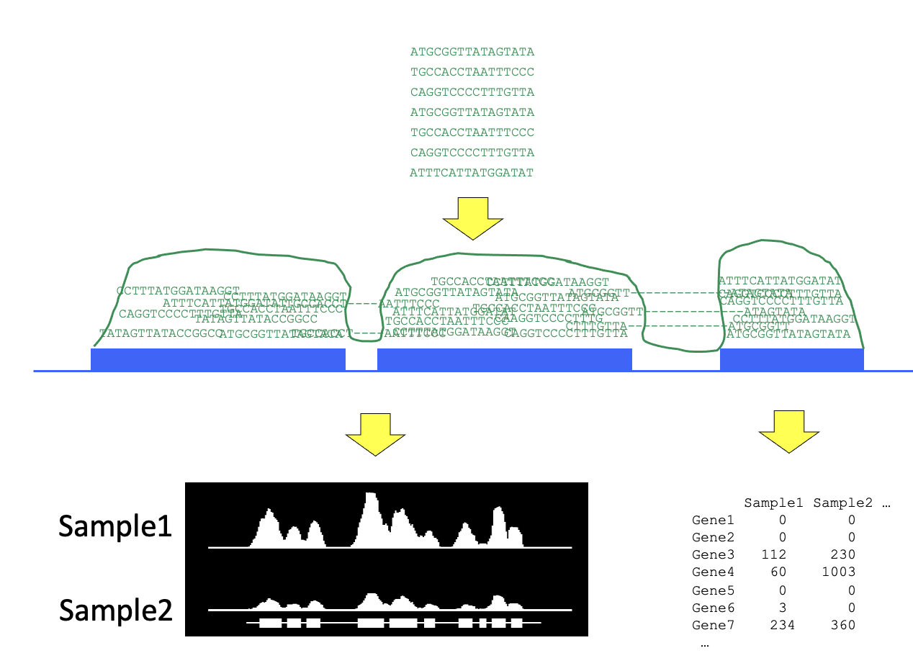
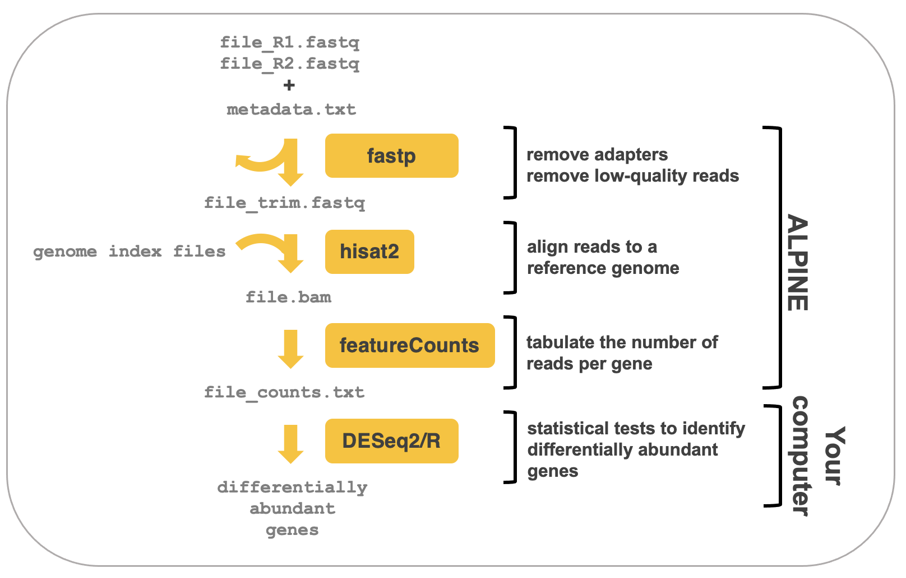
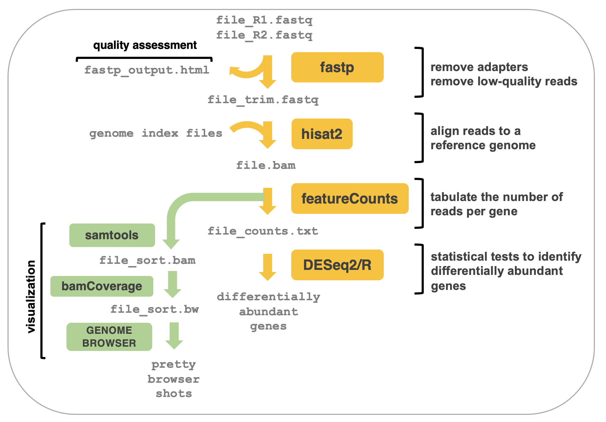
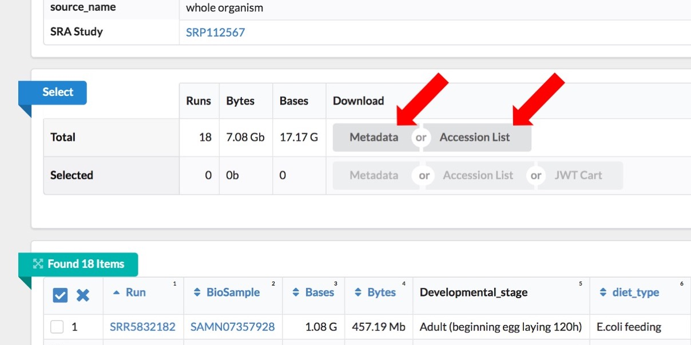

<p align="center">

</p>

# Thursday, November 19, 2026

  * Overviews of upcoming homework and reading
  * ALPINE maintenance days - Wednesdays
  * Go back to Data Acquisition
    * Check everyone has the .fastq files
    * Overview of .fastq file format

-----

# Learning objectives for today

  * Understand how sequence information is encoded in a .fastq file
  * Learn the basic steps in the RNA-seq analysis pipeline and their order
  * Understand what a metadata file is and know how you would make your own metadata files for your own projects
  * Learn how to download a given organism's genome file and annotation file
  * Learn what R is used for and how it is installed

-----

# What is a Pipeline?

A **pipeline** is series of data processing operations in which the output of one process is the input for the next process

<p align="center">

</p>

## A Typical RNA-Seq Data Analysis Pipeline

  1. Align sequenced fragments (called reads) to the genome
  2. Quantify the number of reads associated with each gene
  2. Normalize the samples
  4. Use modeling and statistics to identify differentially expressed genes

<p align="center">

</p>

Each step will involve different software. There are many options for each step:

<p align="center">
 
 <br>
 <em><b>Figure:</b> Adapted from Stark et al., 2019</em>
</p>

**For our pipeline, we will use:**

  * **Hisat2** for alignment
  * **featureCounts** for quantification
  * **DESeq2** for normalization
  * **DESEq2** for differential expression.

In addition, we will need to do some **pre-processing** of our reads. This will remove low quality reads and primer or  adapter sequences that were not from our original sample.

  * **fastp** for pre-processing

All of these software packages, except one, are loaded up in your conda environment `2026dsci`. The one exception is **DESeq2** that will be run on your local laptop computer within `R`.

## Our RNA-seq Data Analysis Roadmap (short version):

<p align="center">
 
</p>

## Our RNA-seq Data Analysis Roadmap (long version):

<p align="center">
 
</p>

**Notice what goes in and what comes out:**

  * **Input:** `file_R1.fastq` and `file_R2.fastq`
  * **Input:** `metadata.txt`
  * **Input:** Genome index files
  * `file_counts.txt` is a major intermediary file
  * **Output:** Differentially abundant genes
  * **Output:** Pretty browser shots
  * **Output:** Plots

Our RNA-seq Analysis Pipeline is largely written in **bash**. You can write your pipeline in any language. 

**Don't want to write a script yourself?** There are many other options:

  * Next flow: [nf-core RNA-seq](https://nf-co.re/rnaseq/3.14.0/)
  * Snakemake: [VIPER: RNA-seq Pipeline](https://pmc.ncbi.nlm.nih.gov/articles/PMC5897949/)

-----

# The Metadata File

**What is a metadata file?**

  * A tab delimited file that lists each samples' names and conditions. 
  * Think of it as the **master list**
  * **Reproducible Research:** We will use and re-use the information in the `metadata` file in each step of the pipeline. 
  * **Names:** A metadata file lists names that you will use for each sample in different steps of the data analysis process. Some of these names will be short (GO01, GO01), but some of them should have a little more information so they can be added to key plots and figures and show you which sample is which (02_Ecoli_15_2).
  * **Conditions and Replicates** A metadata file keeps track of which condition and replicate # is associated with each sample. 

**Let's create a metadata file**

:eyes: **Watch:** These are the steps I took to create the metadata file

  1. I navigated to [NCBI GEO: GSE101524](https://www.ncbi.nlm.nih.gov/geo/query/acc.cgi?acc=GSE101524)
  2. Then I clicked on **SRA Run Selector** at the bottom of that page to take us to: [SRA Run Selector PRJNA394726](https://www.ncbi.nlm.nih.gov/Traces/study/?acc=PRJNA394726&o=acc_s%3Aa)
  3. I downloaded the **Metadata file**

<p align="center">
 
</p>

  4. I opened this in excel using **File** -> **Import**
  5. I deleted columns I didn't need
  6. I added these columns. I compared the SRR numbers with the files I received and used `ls -1 *_1.fast` or `ls -1 *_2.fastq` to obtain the sequence files I have. 
  7. I saved as tab-delimited text. **File** -> **Save As...** -> **Tab-delimited text (.txt)**
  8. I opened in a text editor and double checked there weren't any extra columns or lines

**Group Exercise** 

- Navigate to `~/PROJ01_GomezOrte1/01_input`
- Create a new file called `metadata_gomezOrte.txt`
- Copy and paste:

```
SRR5832182_1.fastq	SRR5832182_2.fastq	EG01	01_Ecoli_15_1	Ecoli	15	1
SRR5832183_1.fastq	SRR5832183_2.fastq	EG02	02_Ecoli_15_2	Ecoli	15	2
SRR5832184_1.fastq	SRR5832184_2.fastq	EG03	03_Ecoli_15_3	Ecoli	15	3
SRR5832185_1.fastq	SRR5832185_2.fastq	EG04	04_Ecoli_20_1	Ecoli	20	1
SRR5832186_1.fastq	SRR5832186_2.fastq	EG05	05_Ecoli_20_2	Ecoli	20	2
SRR5832187_1.fastq	SRR5832187_2.fastq	EG06	06_Ecoli_20_3	Ecoli	20	3
SRR5832188_1.fastq	SRR5832188_2.fastq	EG07	07_Ecoli_25_2	Ecoli	25	1
SRR5832189_1.fastq	SRR5832189_2.fastq	EG08	08_Ecoli_25_1	Ecoli	25	2
SRR5832190_1.fastq	SRR5832190_2.fastq	EG09	09_Ecoli_25_3	Ecoli	25	3
SRR5832191_1.fastq	SRR5832191_2.fastq	EG10	10_Bsubtilis_15_1	Bsubtilis	15	1
SRR5832192_1.fastq	SRR5832192_2.fastq	EG11	11_Bsubtilis_15_2	Bsubtilis	15	2
SRR5832193_1.fastq	SRR5832193_2.fastq	EG12	12_Bsubtilis_15_3	Bsubtilis	15	3
SRR5832194_1.fastq	SRR5832194_2.fastq	EG13	13_Bsubtilis_20_1	Bsubtilis	20	1
SRR5832195_1.fastq	SRR5832195_2.fastq	EG14	14_Bsubtilis_20_2	Bsubtilis	20	2
SRR5832196_1.fastq	SRR5832196_2.fastq	EG15	15_Bsubtilis_20_3	Bsubtilis	20	3
SRR5832197_1.fastq	SRR5832197_2.fastq	EG16	16_Bsubtilis_25_1	Bsubtilis	25	1
SRR5832198_1.fastq	SRR5832198_2.fastq	EG17	17_Bsubtilis_25_2	Bsubtilis	25	2
SRR5832199_1.fastq	SRR5832199_2.fastq	EG18	18_Bsubtilis_25_3	Bsubtilis	25	3
```

- The Metadata document should be in the form:

| Column | Contents | Example |
| --- | --- | --- |
| 1 | 1st .fastq file | SRR5832182_1.fastq | 
| 2 | 2nd .fastq file | SRR5832182_2.fastq | 
| 3 | A short name for each sample - short alphnumeric sorting numbers & letters | EG01 | 
| 4 | A long name for each sample - with condition info | 01_Ecoli_15_1 | 
| 5 | condition #1 | 	Ecoli | 
| 6 | condition #2 (the number of conditions you have will determine how many total column you will have) | 15 | 
| 7 | replicate # | 1 |

> [!NOTE]
> If you only have one condition (strain, for example), you won't need column # 6.


For Homework3, you will be asked to make your own metadata file. Follow the instructions on how to make it. Creating it in excel and then exporting it as a tab-delimited-text-file is a great way to go.

Continue on to [2-6 Building Genome Indexes ](2-6_Building_Indexes.md) 