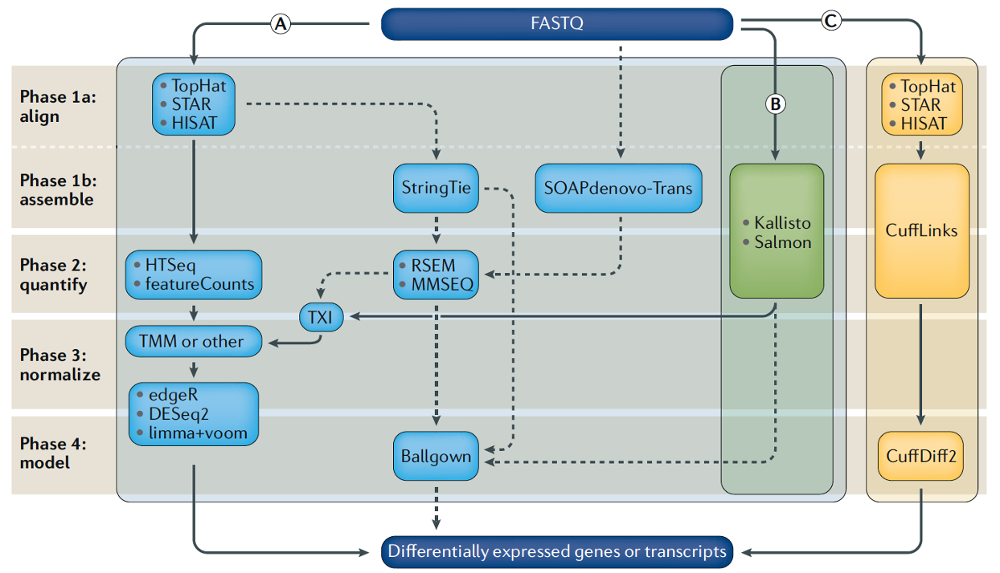

# What is a Pipeline?

A **pipeline** is series of data processing operations in which the output of one process is the input for the next process

## A Typical RNA-Seq Data Analysis Pipeline

  1. Align sequenced fragments (called reads) to the genome
  2. Quantify the number of reads associated with each gene
  2. Normalize the samples
  4. Use modeling and statistics to identify differentially expressed genes

Each step will involve different software. There are many options for each step:

 
  
 <em><b>Figure:</b> Adapted from Stark et al., 2019</em>

**For our pipeline, we will use:**

  * **Hisat2** for alignment
  * **featureCounts** for quantification
  * **DESeq2** for normalization
  * **DESEq2** for differential expression.

In addition, we will need to do some **pre-processing** of our reads. This will remove low quality reads and primer or  adapter sequences that were not from our original sample.

  * **fastp** for pre-processing

All of these software packages, except one, are loaded up in your conda environment `2026dsci`. The one exception is **DESeq2** that will be run on your local laptop computer within `R`.

## Our RNA-seq Data Analysis Roadmap (short version):

 

## Our RNA-seq Data Analysis Roadmap (long version):

 

Notice what goes in and what comes out:

  * **Input:** `file_R1.fastq` and `file_R2.fastq`
  * **Input:** Genome index files
  * `file_counts.txt` is a major intermediary file
  * **Output:** Differentially abundant genes
  * **Output:** Pretty browser shots
  * **Output:** Plots

Continue on to [2-6 The Pipeline](2-6_Building_Indexes.md) 
