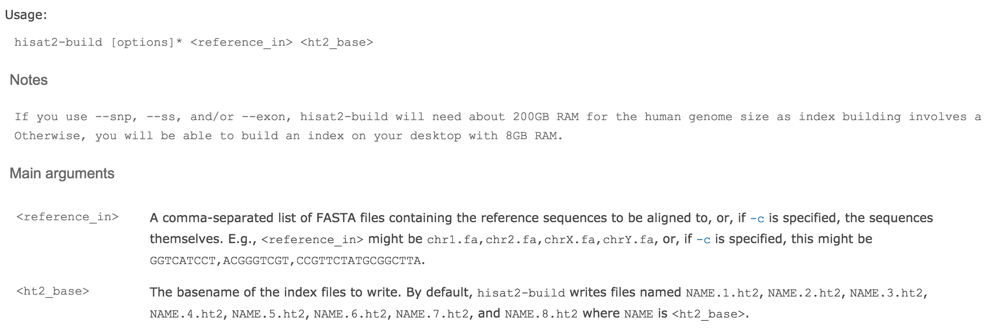
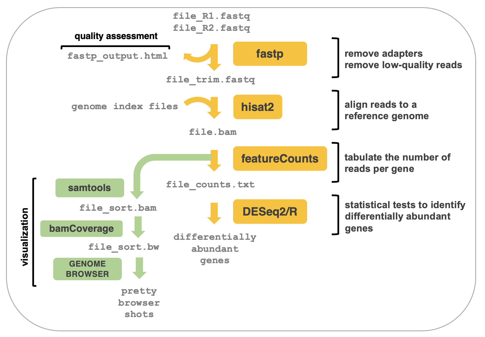

<p align="center">

</p>

# Building HISAT2 Genome Indexes

## References 

- [HISAT2 manual](http://daehwankimlab.github.io/hisat2/manual/)
- [UCSC Genome Browser](https://genome.ucsc.edu/)

----

# Downloading the genome

Because our project involves the *C. elegans* genome, we will now download the *C. elegans* genome and build **Hisat2 indexes** using it. **Hisat2 Indexes** are files that will make it possible to use the *C. elegans* genome as a reference genome in a Hisat2 alignment. This is a very common step in any NextGen sequencing alignment protocol.

To build the Hisat2 indexes, we'll need two things:
  1. The genome as fasta file
  2. A name for our genome that we choose

> [!TIP]
> Standardize your index build names. For this project, we will be making *C. elegans* version235 index build. So the abbreviation will be **ce235**.

:hammer_and_wrench: **Group Exercise:** Build hisat2 indices 

  * Ensure you are on ALPINE, are on the **acompile node**, and have activated your conda environment, and are in the proper folder

```bash
$ acompile --time=03:00:00
$ module load anaconda
$ conda activate 2026dsci
$ cd /scratch/alpine/<eID@colostate.edu>/DSCI512/
```

**Today we will use two sofware packages:**

  * ncbi-datasets-cli
  * hisat2


**Check that you have these installed:**

```bash
conda list
datasets      # you should get instructions. This tests for the ncbi datasets client
hisat2
hisat2-build
```

<details> 
<summary>Click if you need help with software installation </summary>

Check installed software with:

```bash
fastp
bwa
hisat2       #Note: hisat2 will say Error at the bottom because you didn't give it a sequence file. That's ok.
bedtools
samtools
featureCounts
bamCoverage -h
datasets
```

Install any missing software pieces using:

```bash
conda install -c bioconda fastp       
conda install -c bioconda bedtools
conda install -c bioconda samtools
conda install -c bioconda subread
conda install -c bioconda deeptools
conda install -c bioconda bwa
conda install -c bioconda hisat2
```

</details>

  * Start a new project** entitled `PROJ02_ce235IndexBuild`

```bash
$ pwd 
/scratch/alpine/tstark@colostate.edu/DSCI512/
$ mkdir PROJ02_ce235IndexBuild
```

:pencil2: **Write it down!**

  * Write a readme.txt file within this directory
  * Write an entry in your Computational Lab Notebook

**Explore the *C. elegans* genome**

- In a new internet browser tab, navigate to [NCBI Genome Database](https://www.ncbi.nlm.nih.gov/datasets/genome/)
- Search for `Caenorhabditis elegans`
- Click on [**WBcel235**](https://www.ncbi.nlm.nih.gov/datasets/genome/GCF_000002985.6/)
  - Always look for that check mark! 
- Write down the **NCBI RefSeq assembly #** or **Submitted GenBank assembly #**

> [!NOTE]
> You can choose between the RefSeq and GenBank versions. Both are going to be very similar. Here, we'll show you the RefSeq version. 

**Let's download the genome!**

> [!TIP]
> Best practice is to always download your genome and annotation file (.gtf file) together so they are perfectly matched

```bash
datasets download genome accession GCF_000002985.6 --include genome,gtf
unzip ncbi_dataset.zip          # To unzip the folder
md5sum -c *                     # To test if md5 sums match
```

> [!TIP]
> To hack this script and download your own genome, just replace <GCF_000002985.6> with your organism's RefSeq or GenBank #. 

**Organizing and general housekeeeping**

I like to move the .gtf file and .fna files out of the subdirectories and directly into `PROJ02_ce235IndexBuild`. This shortens their paths.

```bash
cd ncbi_dataset
cd data
cd GCF_000002985.6
ls
mv * ../../..
cd ../../..
ls
```

**It should now look like this**

```bash
$ ls -1
GCF_000002985.6_WBcel235_genomic.fna
genomic.gtf
md5sum.txt
ncbi_dataset
ncbi_dataset.zip
README.md
```

**More organization**

Let's rename genomic.gtf to something more specific:

```bash
mv genomic.gtf WBcel235_annotation_genomic.gtf
```

**Data Exploration**

:mag_right: Check out the files you have downloaded!


:pencil2: **Taking Notes:** Ok, now record what you did in a readme file. You can use history. Make sure you include the download command and mention that you checked the md5sums.

----

# Building indexes

Building indexes is computationally intensive. Let's write an .sbatch script to do it

```bash
# Start a script called buildWormIndices.sbatch
$ touch buildWormIndices.sbatch
```

**Copy and paste this code into the program file to initiate it**

```
#!/usr/bin/env bash
 
#SBATCH --job-name=execute_hisat2-build
#SBATCH --nodes=1
#SBATCH --ntasks=4
#SBATCH --time=00:29:00
#SBATCH --partition=acpu
#SBATCH --qos=cpu-testing
#SBATCH --output=log_hisat2-build_%J.out
 
# Test that you have hisat2 working
hisat2
```

Test that the code works. Execute it using:

```
$ sbatch buildWormIndices.sbatch
$ scheck     # test it is working
$ more log_hisat2-build*   # read the output file created
```

**Now add some pseudocode about what we want to do**

```
#!/usr/bin/env bash
 
#SBATCH --job-name=execute_hisat2-build
#SBATCH --nodes=1
#SBATCH --ntasks=4
#SBATCH --time=00:29:00
#SBATCH --partition=acpu
#SBATCH --qos=cpu-testing
#SBATCH --output=log_hisat2-build_%J.txt
 
# Build hisat2 indexes for *C. elegans*
 
 
# Check the build
 
 
# Capture version number
```

**Now let's add code blocks under each line of pseudocode.**

- This is the best practice for writing a script... plan first, code next. Test each block of code as you go.

**Now we need to build some indexes**

- If we look in the HISAT2 manual under the entry for **The hisat2-build indexer**, we'll find the proper usage for building genome indexes:

<p align="center">

</p>

**Usage:** hisat2-build [options] <reference_in> <ht2_base>

```
hisat2-build

options: 
-p <num>             Number of threads to use. The number in this option MUST match the number in the line #SBATCH --ntasks=<num>

<reference_in>       This is the genome as an .fa file. OR, you can use a list of comma-separated file names of all the chromosomes in your genome.
<ht2_base>           This is the name of your new genome. It'll just be ce235 (not the word cell, but ce + the number 11)
```

So, first it'll be just... 

`hisat2-build -p 4`

However, it is good coding practice to pull the number of threads specified in the #SBATCH section using some fancy environmental variables:

`hisat2-build -p ${SLURM_NTASKS}`

You can use `GCF_000002985.6_WBcel235_genomic.fna` as the <reference_in> genome.

Then, just add the last element: 

`ce235`

So, your code in `buildWormIndices.sbatch` should look like this:

```bash
#!/usr/bin/env bash
 
#SBATCH --job-name=execute_hisat2-build
#SBATCH --nodes=1
#SBATCH --ntasks=4
#SBATCH --time=00:29:00
#SBATCH --partition=acpu
#SBATCH --qos=cpu-testing
#SBATCH --output=log_hisat2-build_%J.txt
 
# Build hisat2 indexes for C. elegans
hisat2-build -p ${SLURM_NTASKS} GCF_000002985.6_WBcel235_genomic.fna ce235

# Check the build
echo -e "\n\nINDEX-BUILD: inspecting indexes:"
hisat2-inspect -s ce235
 
# Capture version number
echo -e "\n\nINDEX-BUILD: version:"
hisat2-build --version
```

**Run it!!!**

- Switch over into a **terminal**.
- Make sure you are in the same directory as your file `buildWormIndices.sbatch`
- Then....

```bash
$ sbatch buildWormIndices.sbatch
 
# To check on it:
$ scheck
 
# To watch your index files grow...
$ ls -alh
```

**Did it work???** Check it! You should have a log file and **eight** new files that all have names like `ce235.1.ht2`, `ce235.2.ht2`.

- If your genome <is less than> 4 billion bp, you will always have 8 of these files
- If you genome > 4 billion bp, you will have 16 files

**Inspection of output**

```
projects/.colostate.edu/jesshill/software/anaconda/envs/2025dsci/bin/hisat2-inspect:24: DeprecationWarning: the imp module is deprecated in favour of importlib and slated 
for removal in Python 3.12; see the module's documentation for alternative uses
  import imp
Index version   2.2.1
Flags   1
2.0-compatible  0
SA-Sample       1 in 16
FTab-Chars      10
Sequence-1      chrI    15072434
Sequence-2      chrII   15279421
Sequence-3      chrIII  13783801
Sequence-4      chrIV   17493829
Sequence-5      chrM    13794
Sequence-6      chrV    20924180
Sequence-7      chrX    17718942
Num. SNPs: 0
Num. Splice Sites: 0
Num. Exons: 0
```

----

# Writing a paths file

When we use this index, the one thing we'll need is the path and the prefix. To make it easy for me to find this information in the future, I like to save a file called `paths.txt` that contains this information.

```
$ touch paths.txt
```

Open the paths file and write in it:

```bash
# The path and prefix of this hisat2 build

# The absolute path for the genome

# The absolute path for the .gtf file
```

Next, write the path and index in the following format: `/path/to/this/directory/ce235`

> [!WARNING]
> Just use `ce235` (ce + 235). Don't add anything after it. This will capture all the .ht2 files in the directory

To figure out the path to write,

```bash
$ pwd
```

Add this to your paths.txt file. It should look something like this...

```bash
# The path and prefix of this hisat2 build
/scratch/alpine/$USER/DSCI512/PROJ02_ce235IndexBuild/ce235

# The absolute path for the genome

# The absolute path for the .gtf file
```

**Write the path to your whole genome fasta file and the .gtf file**

It should look something like this with `$USER` substituted as your username

```bash
# The path and prefix of this hisat2 build
/scratch/alpine/$USER/DSCI512/PROJ02_ce235IndexBuild/ce235

# The absolute path for the genome
/scratch/alpine/$USER/DSCI512/PROJ02_ce235IndexBuild/GCF_000002985.6_WBcel235_genomic.fna

# The absolute path for the .gtf file
/scratch/alpine/$USER/DSCI512/PROJ02_ce235IndexBuild/WBcel235_annotation_genomic.gtf

```

---

# Review

Just to review. Here is what we did:

1. Downloaded the *C. elegans* genome and annotation files.
2. Built the hisat2 indices from the *C. elegans* genome using hisat2-build.
3. Checked the build
4. Created a paths file to keep track of key paths for the hisat2 indexes, the genome file, and gtf files


<p align="center">

</p>

Go ahead and update your readme file. Be sure to include:

- A summary of what you did (very brief)
- Any URL locations you used for download
- A mention of the paths.txt file

Continue on to [Overview of R](2-7_Overview_of_R.md)
