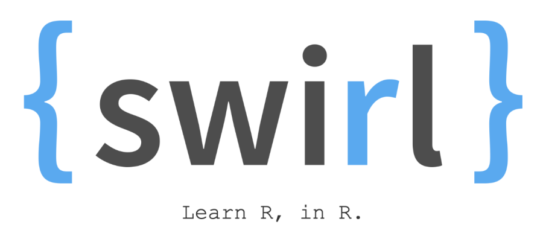
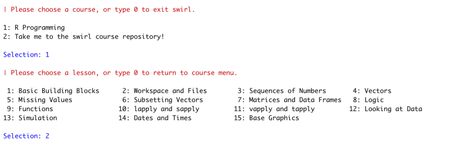
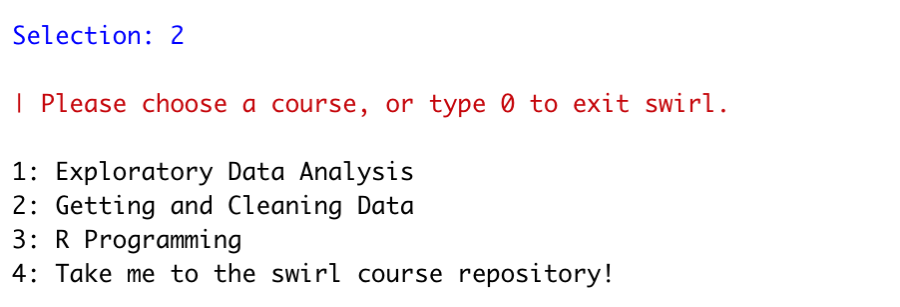

# Assignment #2

  - Due December 1st, 2026, 10:00 am
  - Turn in on canvas

## Learn R : PART 1

Perform this exercise on R Studio using Swirl. Make sure you have R and R studio installed! 

Later in this course, we will be using modules in R to analyze RNA-seq data. To prepare ourselves for those lessons, Homework #2 will take you on a tour of R. Some people already have experience in R, but many do not. Either way, you'll be fine. We will use **Swirl** an interactive R tutorial program and you can learn at the level that suits you best.

[Intro to Swirl for learners](https://swirlstats.com/students.html)

------

## Assignment

**If you are new to R:**

  - If you are new to the R language and environment, please take the first Swirl tutorials. Aim to get through Lessons 1 - 4.
    - Basic Building Blocks
    - Workspaces & Files
    - Sequences of Numbers
    - Vectors
  - However, the idea here is that we can do self-paced learning. If you need to focus on the first two lessons to really understand them, do that. If you want to jam ahead and learn more, you can do that, too. You can still do the sections of the class that involve R even if you don't get through all the suggested lessons.

**If you are an experienced or advanced R user:**

  - Select some new lessons on Swirl to tackle topics you haven't mastered yet.
  - The tidyverse packages, found under “Exploratory Data Analysis” (will cover ggplot2) and “Getting and Cleaning Data” (will cover dplyr), are highly recommend.
  - Feel free to download and take any of the lessons available. These are listed on [github](https://github.com/swirldev/swirl_courses) and on the [swirl webpage](https://swirlstats.com/students.html).
  - Work through the lessons that challenge you.

## Lesson Options

Base R lessons on Swirl:

Advanced R lessons on Swirl:

If you don't see these advanced lessons, check the reference information: [The Swirl Course Network](https://swirlstats.com/scn/title.html)

## What to turn in

Please answer the following and turn it in:

  - **Report** What did you work on?
  - **Assess** What was your R experience at the beginning of the exercise? 
  - **Evaluate** What did you learn? What did you find most useful?
  - **Review** Was this a good lesson? Would you recommend it to other students?
