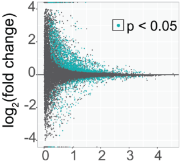

# DSCI512: RNA-sequencing Data Analysis

## Welcome to the course 'RNA-Sequencing Data Analysis'

RNA-seq is a commonly used method for analyzing gene expression. This course will provide hands-on experience processing and analyzing high-throughput sequencing data, with an emphasis on RNA-seq.

Please see the [Syllabus](#schedule)

Please read the [Syllabus](#syllabus)

Please start the course through Modules

Please see the Computer Requirements

-----

# Schedule

| Date  | Module | Description | Reading | Assignments |
|-------|------|-------------|---------|-------------|
| Nov 10 | [Week1] |  |  |  |
| Nov 12 | [Week1] |  |  |  |
| Bonus Content |  |  |  |  |
| Nov 17 | [Week2] |  |  |  |
| Nov 19 | [Week2] |  |  |  |
| Bonus Content | [Week2] | | | |

------

# Syllabus

## Contents

- [Learning Objectives](#learning-objectives)
- [Time & Place](#time-and-place)
- [Attendance](#attendance)
- [Prerequisites](#prerequisites)
- [Textbook](#textbook)
- [Study Sessions](#study-sessions)
- [Instructor](#instructor) 
- [Grading](#grading)
- [Assignments](#assignments)
- [Student Disability Accommodations](#student-disability-accommodations)
- [Other Accommodations](#other-accommodations)
- [Privacy Policy](#privacyposting-policy)
- [Expectations](#expectations)
- [Health & Safety](#health-and-safety)
- [AI Statement](#ai-statement)
- [Additional Documents](#additional-documents)

## Learning Objectives

By the end of this course, you should master the following learning objectives:

  * Understand the goals, benefits, and limitations of RNA sequencing (RNA-seq)
  * Understand RNA-seq experimental design
  * Know the common RNA-seq analysis steps: quality control, alignment, tabulation, differential expression, and clustering
  * Be able to write (or at least hack) automated pipelines for RNA-seq analysis
  * Be familiar with best practices

By the end of the course, students will have the following skills:

  * Obtain, handle, and process high-throughput sequencing data
  * Perform high-throughput sequencing data quality control and filtering
  * Align sequence reads to the genome
  * Perform differential gene expression analysis
  * Create output plots and data visualization

## Time and Place

Lectures: __Tuesdays and Thursdays, 10:00 - 11:50 am in AZ E210__ starting Tuesday, Nov 10, 2026 and finishing Thursday, December 10, 2026. 

## Attendance

Class attendance is not mandatory, but please let me know if you will be attending multiple classes remotely or making them up at a later time. I just want to make sure I know who is still engaged.

I will try my best to post Echo360 recordings after the class on Canvas. Due to a lengthy conversion process, videos will not be available until late afternoon or the following day. 
Please note - coming to class is the best way to learn. The in-class content will be very interactive with individualized help available in the classroom.

## Prerequisites

Linux as a computational platform (DSCI 510) or familiarity with UNIX/Linux and working from the command line.

## Requirements

Please see the course REQUIREMENTS for information on the computer you should bring to class, requesting SUMMIT access, and required software.

## Textbook

There is no textbook for this course. Reading assignments are papers describing the techniques used in the course.

## Study Sessions

We will have study sessions every __Friday from 9 am – 10 am, in AZ E210__ (same classroom). 
You don't need to come to the study session with a question. You can come to work on your homework assignments. 

## Instructor

Erin Osborne Nishimura, PhD	(she/her)

Department of Biochemistry & Molecular Biology

Cell and Molecular Biology Professor

erinnish@colostate.edu or canvas e-mail

Please e-mail me with any questions through regular e-mail or canvas e-mail. Course content-related questions that are e-mailed to instructors may be posted (anonymously) on Canvas Discussions for a faster response and to broadcast insight to the group. Personal or individual concerns will not be disclosed in that way.

## Grading

Your grade for this course will be based on assignments, readings, lab notebook, and a final exam. The percentages are as follows:

  * Assignments: 35 %
  * Readings: 15 %
  * Quizzes (on Canvas): 15 %
  * Final project: 35 %

The calculation of the final letter grade will be made as follows:

  * A 90 - 100%
  * B 80 - 89.9%
  * C 70 - 79.9%
  * D 60 - 69.9%
  * F below 60%

These ranges for a letter grade might be shifted a little lower, but will not be raised. We reserve the right to distribute + or - grades.

Late assignments will be accepted if you make arrangements with the instructor 24 hrs before the due date. You will be given 48 additional hours to complete the assignment.

__Assignments__ - There will be 5 assignments worth 7 pts each for a total of 35 possible points.

__Readings__ – Three will be 5 readings worth 3 pts each for a total of 15 possible points.

__Quizzes__ – will be available on canvas.

## Student Disability Accommodations

SDC accommodations: I recognize that the Student Disability Center is behind in issuing accommodation letters. If you have a situation that requires SDC accommodations, please e-mail me directly and we can make arrangements. You can do this even before your official paperwork is processed in the SDC. This class has a lot of flexibility for all students with or without letters.

## Other Accommodations

This class is aimed at graduate students beyond their first year of coursework. As such, I realize students are engaged with research and exams. This class is designed to be sufficiently flexible to accommodate a reasonable number of absences and other time commitments. However, please be aware that you also have other options, such as auditing the class.

To audit the class, you do 1) come to class as you like, 2) do the activities as you like, 3) participate as you like. Auditors do NOT enroll, receive credit, receive a final grade, turn in assignments, or receive feedback on assignments. Please let me know quickly if this is an attractive option for you, as the withdrawal date for this class is the first week.

## Privacy/Posting Policy

Distribution of course material is not permitted by the instructor. This means you are not permitted to post course content, course videos, or representations of the class online. We are offering recordings for students to assist them in learning. Please be respectful of people's privacy with these recordings and content.

## Expectations

You are expected to be familiar with the [Student Code of Conduct](https://resolutioncenter.colostate.edu/conduct/code/). This course will adhere to the [CSU Academic Integrity Policy](https://resolutioncenter.colostate.edu/conduct/academic-integrity/). At a minimum, violations will result in a grading penalty in this course, a report to the Office of Conflict Resolution and Student Conduct Services, and communication with your professor and/or graduate program director.

Colorado State University has clear [Principles of Community](https://inclusiveexcellence.colostate.edu/about/principles-of-community). We each have the responsibility to uphold these values as we interact with one another and learn.

Please know that use of GradeBuddy, Chegg, Course Hero, or other web services that market themselves as tutoring or study guides are not permitted in this course. Many instances of their use are a violation of the Student Integrity Policy. Please note that Plagiarism will not be tolerated. Learn more through [Academic Misconduct Resources](https://tilt.colostate.edu/integrity/studentresources/).

## Health and Safety

Don't feel pressured to come to class if you are ill. Staying home when you are sick prevents the spread of disease. If this happens, you can use the recorded options. 

## AI Statement

_Things may change in future classes. Other professors will have different statements._

_I implore everyone to think deeply about their own personal goals for this class. What do you want to master? What do you want to take with you after you leave?_

_Chances are, you want to gain a skillset to apply to your research and career._

_The best practices for learning new skills are to practice, struggle, experiment, spend time, think deeply, and sit with the material._

_AI has advantages and disadvantages in this learning process._

### Beneficial usage and suggestions

  * **Search function:** This is an area where AI tools can be very useful in helping you to select a dataset or manuscript in your area of interest.
  * **Conversational:** A prompt like “Teach me how to use a for loop in bash scripting” can organize information succinctly without ads.
    * Warning: information is not always accurate
  * **Grammar & light editing:** Using AI to decode tricky English turns-of-phase or assist with grammar and clarity.
    * Please use caution, as AI tools tend to change the meaning of your words, not just the wording.
  * **Coaching:** You can use AI to coach you through hard sections once you have tried to work them out on your own. You can use AI to explain why something isn’t working.
  * **Extension:** You can use AI to write sections of your exam project that are beyond the scope of this course. Just document these sections. 

### Disallowed usage:

  * Generative usage is NOT allowed – Do not use AI to de novo write your code for assignments or the final project, as this can negatively impact learning. 
  & Using AI on the quizzes is not allowed.

### Unsure about what is ok and not ok?

You can always e-mail me to ask. Also, if you would like to disclose your usage of AI in any assignment or in the Exam Project, I encourage you to do so. You can include a statement like…

  * I did not use AI for this assignment.
  * AI assisted with grammar and readability, but the original writing was my own.
  * AI assisted me with search functions and organizational tasks associated with this project. 
  * AI helped with idea generation, but I wrote the assignment myself.
  * AI wrote a significant portion of this work, but I edited it.
  * Coding lines 50 – 72 were generated by AI to integrate a gene identifier function into my script. That function was beyond my knowledge and the course’s requirements, but it assisted me in translating the gene names of my organism for downstream use. 

### AI is a part of coding and it is evolving

I also acknowledge that AI has become a large part of the coding experience and your usage of it will evolve over time. The restrictions here are meant to foster learning within the scope of this class, and are not meant as general best practices to follow after the class concludes. 

### Reach out if you need more time

Please contact me if you feel overwhelmed or are falling behind in the class. I'd rather give you the time and opportunity to learn the content than to have you in a situation where you feel you need to speed through content using AI.

## Additional Documents

  * [Erin Teaching Statement](04_resources/Nishimura_TeachingStatement_261104.pdf)
  * [Additional Resources](04_resources/Resources%20and%20Policies_Nishimura_260819.docx)

-----

